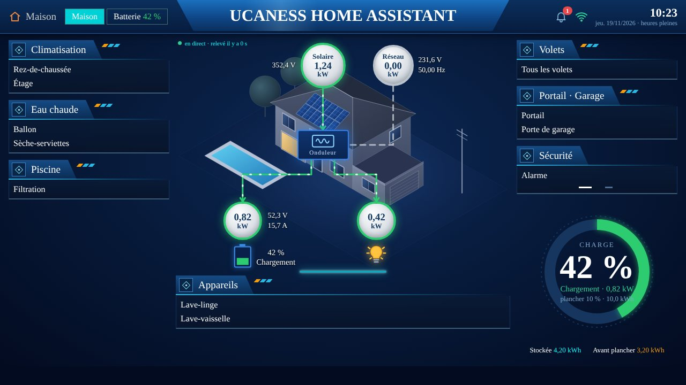

# Tableau de bord « UCANESS HOME ASSISTANT »

Un tableau de bord Home Assistant qui prolonge le portail UCANESS : même police, mêmes cartouches de panneau, mêmes couleurs, et la vue en direct de la maison au centre. Autour, le pilotage des appareils de la maison ; dans un second onglet, tout ce qui concerne la batterie.



| Onglet | Contenu |
|---|---|
| **Maison** | Au centre, la maison en direct : solaire, réseau, onduleur, batterie et consommation, avec des flux animés dans le sens de l'énergie. Autour, vos appareils : climatisation, eau chaude, piscine, volets, portail et garage, sécurité, caméras, prises mesurées |
| **Batterie** | Production et consommation (tableau de bord Énergie), charge de la batterie, conditions du jour (mode, heures creuses, prévision solaire), détails de l'onduleur, puissances sur 24 h, charge et décharge par jour, santé, pilotage de nuit |

## 1. Contenu du dossier

| Fichier | Rôle |
|---|---|
| `www/ucaness/ucaness-cards.js` | Cartes personnalisées, en un seul fichier, sans dépendance ni compilation |
| `www/ucaness/maison-exemple.svg` | Maison d'exemple affichée tant que vous n'avez pas mis la vôtre |
| `www/ucaness/fonts/` | Police Tinos (métriquement identique à Times New Roman), servie localement |
| `themes/ucaness.yaml` | Thème « UCANESS » pour les cartes standard de Home Assistant |
| `dashboards/ucaness-home-assistant.yaml` | Le tableau de bord (deux onglets), en mode YAML |
| `tools/maison_iso.py`, `tools/maison-exemple.json` | Générateur de maison isométrique (voir `MAISON.md`) |
| `MAISON.md` | Prérequis et méthode pour afficher **votre** maison au centre |
| `tests/` | Aperçu hors Home Assistant et tests |

## 2. Prérequis

| Élément | Remarque |
|---|---|
| Home Assistant 2026.x | Cartes standard utilisées : `tile` (avec fonctions), `entities`, `history-graph`, `statistics-graph`, cartes Énergie, `weather-forecast`, `picture-entity` |
| Intégration `ucaness` (ce dépôt) | Entités renommées en `sensor.uhome_*` (§ 3, étape 5) |
| Tableau de bord Énergie configuré | Pour les panneaux Production et Consommation de l'onglet Batterie (voir le README principal, § 3) |
| Packages de pilotage (`pilotage/`) | Facultatifs : panneau « Pilotage de nuit », plancher et capacité de l'anneau de charge, heures creuses et prix |
| Prévision Solcast, intégration météo | Facultatives : lignes « Solaire prévu » et carte météo |

## 3. Installation

1. **Fichiers.** Copier `www/ucaness/` dans `config/www/ucaness/` (application « Samba share » ou « File editor »). Le dossier `www` est servi à l'adresse `/local/`.
2. **Ressource.** Paramètres → Tableaux de bord → ⋮ → Ressources → Ajouter une ressource :
   - URL : `/local/ucaness/ucaness-cards.js?v=0.2.4`
   - Type : module JavaScript

   Changer le numéro après `?v=` à chaque mise à jour du fichier, pour forcer les navigateurs à le recharger.
3. **Thème.** Copier `themes/ucaness.yaml` dans `config/themes/`, avec dans `configuration.yaml` :
   ```yaml
   frontend:
     themes: !include_dir_merge_named themes/
   ```
   Le tableau de bord applique le thème à ses deux onglets (`theme: UCANESS`) sans changer celui du reste de Home Assistant.
4. **Tableau de bord.** Copier `dashboards/ucaness-home-assistant.yaml` dans `config/dashboards/`, puis dans `configuration.yaml` :
   ```yaml
   lovelace:
     dashboards:
       ucaness-maison:
         mode: yaml
         title: UCANESS
         icon: mdi:home-lightning-bolt
         show_in_sidebar: true
         filename: dashboards/ucaness-home-assistant.yaml
   ```
   Le nom `ucaness-maison` donne l'adresse des onglets (`/ucaness-maison/maison`, `/ucaness-maison/batterie`). Si vous en choisissez un autre, changez aussi les `path` des onglets dans l'en-tête.
5. **Entités.** Sur une installation neuve de l'intégration, les entités portent déjà l'identifiant attendu. Sur une installation plus ancienne, les renommer (Paramètres → Entités, champ « ID de l'entité ») : celles du tableau `pilotage/README.md` (étape 2), plus :

   | Entité d'origine | ID attendu |
   |---|---|
   | UCANESS : puissance solaire | `sensor.uhome_puissance_solaire` |
   | UCANESS : tension solaire | `sensor.uhome_tension_solaire` |
   | UCANESS : tension réseau | `sensor.uhome_tension_reseau` |
   | UCANESS : fréquence réseau | `sensor.uhome_frequence_reseau` |
   | UCANESS : tension batterie | `sensor.uhome_tension_batterie` |
   | UCANESS : courant batterie | `sensor.uhome_courant_batterie` |
   | UCANESS : santé batterie (SOH) | `sensor.uhome_sante_batterie` |
   | UCANESS : température onduleur | `sensor.uhome_temperature_onduleur` |
   | UCANESS : charge batterie totale | `sensor.uhome_charge_batterie_totale` |
   | UCANESS : décharge batterie totale | `sensor.uhome_decharge_batterie_totale` |

   Une entité absente n'empêche pas l'affichage : la valeur est remplacée par « — ».
6. **Vos appareils.** Les entités marquées `# EXEMPLE` dans le fichier YAML (climatisation, ballon, piscine, volets, portail, alarme, caméra, prises) sont à remplacer par les vôtres. Supprimez les cartes des appareils que vous n'avez pas.
7. **Votre maison.** Voir `MAISON.md`.
8. Vérifier la configuration, redémarrer Home Assistant, puis ouvrir « UCANESS » dans la barre latérale.

## 4. Cartes

### `custom:ucaness-layout-card`

| Option | Défaut | Rôle |
|---|---|---|
| `header` | — | Options de l'en-tête (ci-dessous) |
| `columns` | obligatoire | Liste de colonnes : `width` (`300px`, `1fr`…) et `cards` |
| `gap` | `12px` | Espace entre les colonnes |
| `mobile_breakpoint` | `900` | Largeur (px) sous laquelle tout passe sur une colonne |
| `mobile_first_column` | colonne du milieu | Colonne affichée en premier sur téléphone |

### `custom:ucaness-header-card`

| Option | Rôle |
|---|---|
| `title`, `site` | Titre du bandeau, nom affiché à gauche |
| `tabs` | Onglets : `title`, `path`, et `entity` facultative dont la valeur s'affiche dans l'onglet |
| `connectivity_entity` | Capteur binaire de liaison (icône verte ou rouge) |
| `alert_entities` | Capteurs binaires comptés dans la pastille d'alertes quand ils sont à « on » |
| `subtitle` ou `subtitle_entity` | Texte sous l'heure |

### `custom:ucaness-panel-card`

| Option | Rôle |
|---|---|
| `title`, `cards` | Titre du cartouche et cartes contenues |
| `slides`, `interval` | Carrousel : liste de `{title, cards}` qui défilent toutes les `interval` secondes (8 par défaut, 0 pour arrêter). Après un choix manuel, le défilement reprend à zéro |
| `tabs` | `true` : les `slides` deviennent des onglets nommés en haut du panneau (`tab` pour le nom, `icon` facultative, `cards`), le titre `title` reste fixe et rien ne défile seul |
| `status_entity` | Valeur affichée à droite du cartouche |

### `custom:ucaness-flow-card`

| Option | Défaut | Rôle |
|---|---|---|
| `image` | `maison-exemple.svg` | Image de la maison (voir `MAISON.md`) |
| `aspect_ratio` | `1.45` | Largeur / hauteur de la carte |
| `image_area` | `{x: 0, y: 6.5, w: 100}` | Position et largeur de l'image, en % de la carte |
| `min_power` | `30` | En dessous (W), un flux est considéré au repos (pointillés gris) |
| `calibration` | `false` | Grille de calage graduée en % |
| `nodes` | voir ci-dessous | `solar`, `grid`, `inverter`, `battery`, `home` |

Chaque nœud accepte `entity`, `x` et `y` (en % de la carte), `label`, `details` (entités affichées à côté, par exemple tension et courant), `details_side` (`left` ou `right`), `invert` (inverse le signe de la puissance) et `path` (tracé imposé, liste de points `[x, y]` en %). Le nœud `battery` prend aussi `soc_entity`.

Conventions de signe de l'intégration : batterie positive en charge, réseau positif en soutirage. Un appui sur une boule ouvre la fiche de l'entité.

### `custom:ucaness-note-card`

Texte replié sur quelques lignes et terminé par « … » : le module garde la taille des autres. Un appui sur le texte ou sur « … » le déplie en entier, « Réduire » le replie. Un texte assez court pour tenir s'affiche normalement, sans « … ». Un lien dans le texte s'ouvre sans le déplier.

Pour l'utiliser, remplacer `type: markdown` par `type: custom:ucaness-note-card` en gardant `content:`.

| Option | Défaut | Rôle |
|---|---|---|
| `content` | — | Texte markdown (modèles acceptés, comme dans une carte markdown) |
| `card` | — | À la place de `content` : n'importe quelle autre carte à replier |
| `lines` | `4` | Nombre de lignes visibles, texte replié |
| `mobile_lines` | `lines` | Nombre de lignes visibles sous 900 px de large |

```yaml
- type: custom:ucaness-note-card
  lines: 4
  content: |-
    #### Une journée de la batterie
    ...
```

### `custom:ucaness-soc-card`

Options : `soc_entity`, `power_entity`, `floor_entity` ou `floor` (%), `capacity_entity` ou `capacity` (kWh). Par défaut, les entrées des packages de pilotage.

### Mode allégé

Sur une tablette peu puissante, ajouter `?leger=1` à l'adresse du tableau de bord (par exemple `/ucaness-maison/maison?leger=1`) : les animations sont coupées. Le choix est mémorisé sur l'appareil ; `?leger=0` le retire. Les cartes ne se redessinent que lorsque leurs propres entités changent.

## 5. Sécurité

- **Confirmations.** Le portail, la porte de garage et le mode de pilotage de la batterie s'actionnent par un appui avec confirmation. N'ajoutez pas de boutons rapides (`features`) sur ces cartes : ils agissent sans confirmation.
- **Fichiers publics.** Tout ce qui est dans `config/www` est lisible sans mot de passe à l'adresse `/local/…` par quiconque atteint votre Home Assistant. N'y mettez rien de confidentiel (voir `MAISON.md`, § 4).
- **Caméras.** Respectez la vie privée des voisins et des personnes filmées.

## 6. Aperçu sans Home Assistant

```bash
cd dashboard
python -m http.server 8765
# puis ouvrir http://localhost:8765/tests/apercu.html
```

L'aperçu utilise des valeurs inventées et remplace les cartes standard par des lignes simples. `tests/cartes.html` montre de la même façon le texte repliable et le panneau à onglets.

## 7. Tests

```bash
pip install -r requirements_test.txt playwright==1.63.0   # depuis la racine du dépôt
python -m playwright install chromium
pytest -p no:homeassistant -p no:socket dashboard/tests -q
```

Les tests vérifient le fichier YAML, la cohérence entre le tableau de bord, les cartes et la liste des entités, le générateur de maison, l'absence de données personnelles dans le dossier, la version annoncée de la ressource, et le rendu des cartes dans Chrome : flux, carrousel, onglets, texte repliable (ordinateur et téléphone), redessin limité, mode allégé (ignoré si Playwright n'est pas installé).

## 8. Licences et marques

Code : MIT (fichier `LICENSE` du dépôt). Police Tinos : SIL Open Font License 1.1 (`www/ucaness/fonts/OFL-Tinos.txt`). UCANESS est le nom du portail d'UCanpower ; ce tableau de bord en reprend la présentation pour s'y intégrer.
